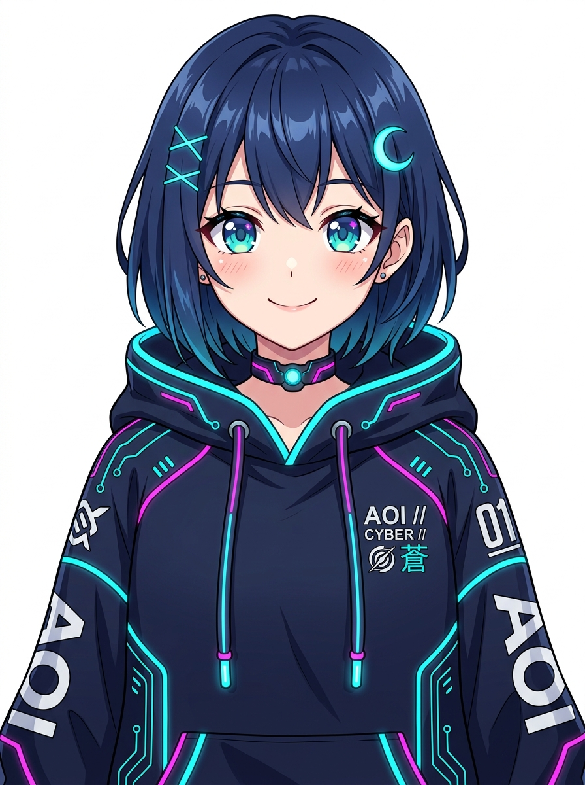
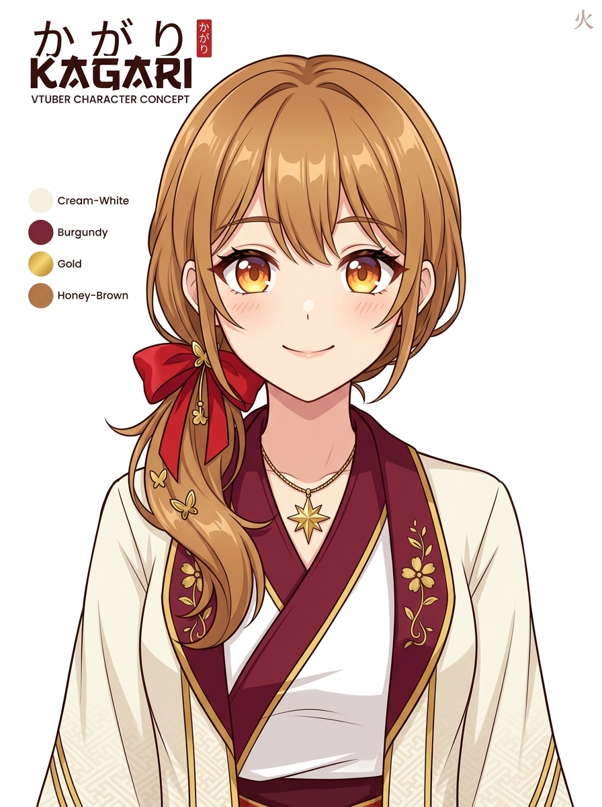

# Character Art Direction Proposal: Japanese Anime Female VTuber

## 1. Executive Summary & Design Scope
This document defines two succinct, cohesive character art direction options for ONE original Japanese-anime-style female VTuber, optimized specifically for **webcam portrait/upper-body streaming in Warudo and OBS Studio**.

In accordance with `docs/MODEL_RIG_ARCHITECTURE.md`:
- **70% of modeling effort** is reserved for the head, face, hair silhouette, and upper chest/collar area.
- All shapes are designed to read cleanly at 128px avatar icon size and in high-contrast webcam lighting.
- Bangs and hairstyles leave clear clearance for eyebrows and pupils to ensure high-fidelity MediaPipe optical tracking.

---

## 2. Character Direction Option 1: "Aoi (蒼) — Neo-Cyber Streamer"

### Core Archetype & Vibe
- Upbeat, tech-savvy cyber pop idol / gamer streamer. Modern street-tech aesthetic with clean anime proportions.

### Color Hierarchy
- **Dominant (60%)**: Deep Midnight Navy (`#141B2D`) & Off-White (`#F0F4F8`).
- **Support (30%)**: Vibrant Neon Cyan / Aqua Teal (`#00E5FF`).
- **Accent (10%)**: Holographic Magenta / Coral Pink (`#FF2A85`).

### Hair Shape Language & Silhouette
- Medium layered anime bob with side-swept fringe.
- Crescent moon & cross cyber hairpins on right temple.
- Sharp, feathered clumps tapering cleanly at the jawline without occluding the neck or collar.
- High-contrast edge silhouette recognizable at thumbnail/icon scale (128px).

### Eyes & Facial Proportions
- Large expressive anime eyes with dual-tone teal-to-cyan gradient and twin star specular highlights.
- Defined upper eyelid lash line with distinct corner flick.
- High-contrast pupil/sclera boundary to maximize MediaPipe eye gaze/LookAt tracking accuracy.
- Clear arched anime eyebrows with zero hair occlusion.

### Outfit & Upper-Body Details (Streamer Framing)
- Oversized cyber-tech hoodie with structured collar.
- Stylized glowing circuit trim along hoodie seams and drawstrings.
- Minimalist tech choker with central LED node.
- No dangling waist ornaments crossing webcam framing.

### 3 Key Must-Match Attributes
1. Distinct teal-gradient anime iris with sharp upper eyelid contour.
2. Clean layered hair clumps with clear eyebrow clearance for tracking.
3. High-contrast cyber-tech hoodie silhouette with clean MToon cel shading.

### 3 No-Go Features
1. Overly realistic nose bridge or textured human skin pores (breaks 2.5D toon aesthetic).
2. Hair strands clipping into or obscuring the eyebrows or eye sockets.
3. Heavy, noisy micro-details (cables, loose keychains) that cause aliasing or distracting physics jitter during head turns.

---

## 3. Character Direction Option 2: "Kagari (篝) — Astral Shrinekeeper"

### Core Archetype & Vibe
- Gentle, warm celestial shrine maiden / modern astral guardian. Elegant, cozy, and approachable anime aesthetic.

### Color Hierarchy
- **Dominant (60%)**: Warm Cream-White (`#FFF9F2`) & Warm Burgundy/Carmine (`#8B1E3F`).
- **Support (30%)**: Sunset Honey-Amber (`#F5A623`) & Soft Warm Brown (`#8D5B4C`).
- **Accent (10%)**: Radiant Astral Gold (`#E6B800`) & Cherry Blossom Peach (`#FFAAA6`).

### Hair Shape Language & Silhouette
- Soft honey-brown hair styled in an asymmetrical low side-ponytail tied with a crimson silk ribbon.
- Parted curtain bangs cleanly framing the forehead and temples.
- Gentle curved clumps with subtle ribbon dynamic potential.
- Warm, soft silhouette reading cleanly in streaming portrait view.

### Eyes & Facial Proportions
- Warm amber-gold anime eyes with radiant sunset gradient and crescent catchlights.
- Softer, rounded anime eye contour with gentle outer lash wings.
- Friendly, subtle resting micro-smile for natural streaming presence.
- Unobstructed eyebrows allowing full range of emotional blendshapes (`happy`, `sad`, `surprised`).

### Outfit & Upper-Body Details (Streamer Framing)
- Modernized shrine maiden (miko/haori) crossover collar with gold trim and delicate floral embroidery.
- Minimalist 8-point astral star pendant on fine chain.
- Crisp white under-kimono layer providing strong neck contrast.

### 3 Key Must-Match Attributes
1. Warm amber-gold radiant anime eyes with gentle curved lash contours.
2. Asymmetrical side-ponytail silhouette balanced with curtain fringe.
3. Elegant two-tone burgundy and cream crossover collar with gold astral accent.

### 3 No-Go Features
1. Low-contrast eye whites or washed-out iris colors that degrade webcam gaze tracking.
2. Long, dangling hair tassels that collide with the neck during extreme head yaw.
3. Muddy photorealistic shading or excessive specular highlights on skin.

---

## 4. Checkpoints & Review Artifacts
- **Gate A Checkpoint**: Concept selection (Option 1 vs Option 2 or user custom feedback).
- **Gate B Checkpoint**: Head & Face prototype renders:
  - `outputs/previews/gate_b_face_front.png` (technical neutral studio light)
  - `outputs/previews/gate_b_face_threequarter.png` (beauty toon light)
  - `outputs/previews/gate_b_face_side.png` (silhouette & nasal plane check)
  - `outputs/previews/gate_b_face_closeup.png` (eyelid & mouth deformation loop inspection)
